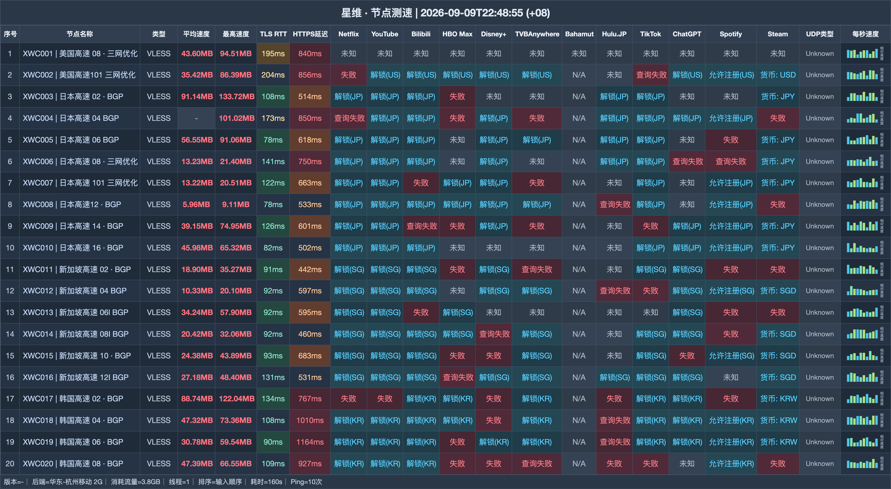

# 星维机场测评｜160G 月付 8 元，年付每月 240G（2026-11-09 更新）

> **先看结论：8 元月档适合先试，80 元年付适合稳定长期使用，低频用户还能选不限时流量包。**
>
> 👉 **[进入注册页](https://xinweicloud.com/?mode=register&invite=ICg5rb7n)** · 先买 8 元 160G 月档；长期稳定后再切 80 元年付。

## 哪些人更匹配

- 预算有限，希望用 8 元开始测试的人
- 确定长期使用并愿意年付的人
- 流量不规律、偏好永不过期流量包的人

## 哪些情况建议跳过

- 更换套餐时不能接受流量重置的人
- 要求设备数和限速在购买前完全写明的人

| 快速判断 | 当前信息 |
|---|---|
| 月付首档 | 160G / 8 元 |
| 年付方案 | 每月 240G / 80 元 |
| 年付月均 | 约 6.67 元 |
| 大月档 | 1000G / 38 元 |
| 不限时起点 | 200G / 20 元 |
| 接入协议 | VLESS |

**站点定位**：星维（xinwei / xinweicloud）以 8 元 160G 月档起步；80 元年付每月 240G，另有可叠加的不限时流量。

## 全部套餐怎么排

| 套餐 | 价格 | 流量 | 设备 | 限速 | 说明 |
|---|---:|---:|---:|---:|---|
| 年付每月240G | ¥80/年付 | 240G · 每月 | — | — | 标题10+2；有效期明确365天 |
| 月付每月160G | ¥8/月付 | 160G · 每月 | — | — | — |
| 季付每月160G | ¥20/季付 | 160G · 每月 | — | — | — |
| 半年付每月160G | ¥40/半年付 | 160G · 每月 | — | — | — |
| 月付增强版每月300G | ¥15/月付 | 300G · 每月 | — | — | — |
| 季付增强版每月300G | ¥42/季付 | 300G · 每月 | — | — | — |
| 半年付增强版每月300G | ¥80/半年付 | 300G · 每月 | — | — | — |
| 月付超级增强版每月500G | ¥21/月付 | 500G · 每月 | — | — | — |
| 月付至尊增强版每月1000G | ¥38/月付 | 1000G · 每月 | — | — | — |
| 不限时200G | ¥20/一次性 | 200G · 用完为止 | — | — | 多次购买可叠加 |
| 不限时500G | ¥45/一次性 | 500G · 用完为止 | — | — | 多次购买可叠加 |

**购买前提醒：**续相同套餐不重置流量；换套餐会折抵剩余价值后重置。测速运行环境为华东-杭州移动。

## 节点测速图

现有图包含 20 行下载与延迟记录，测试端是 华东-杭州移动 2G，使用 1 线程。图的页面归属存在标题与图注不一致，不能把它单独当作星维线路保证。 图中日期为 **2026-09-09**，完整表格如下：

## 选择顺序

1. 第一次先选 8 元 160G，同时确认设备、限速和特殊商品退款条件。
2. 长期使用再比较 80 元年付：有效期 365 天、每月 240G；标题中的 10+2 不另算额外月份。
3. 低频需求用 20 元 200G 不限时包，多次购买可以叠加。

## 注册入口

👉 **[打开注册页面](https://xinweicloud.com/?mode=register&invite=ICg5rb7n)** · 先买 8 元 160G 月档；长期稳定后再切 80 元年付。

*本文含推广链接；通过该入口注册或购买，本站可能获得佣金。*

## 本文更新

- **2026-11-09** — 每日复核：套餐、价格与公告无变化；多账号发布对齐核查完成。
- **2026-11-08** — 每日复核：套餐、价格与公告无变化；多账号发布对齐核查完成。
- **2026-11-07** — 每日复核：套餐、价格与公告无变化；多账号发布对齐核查完成。
- **2026-11-06** — 每日复核：套餐、价格与公告无变化；多账号发布对齐核查完成。
- **2026-11-05** — 每日复核：套餐、价格与公告无变化；多账号发布对齐核查完成。
- **2026-11-04** — 每日复核：套餐、价格与公告无变化；多账号发布对齐核查完成。
- **2026-10-31**：重新编排购买建议与全部套餐，共保留 10 个套餐/展示项。
- **2026-09-09**：节点测速图所示日期。

---
*套餐价格、节点与活动可能调整，付款前请以购买页当时显示为准。*

展开相关搜索词

搜索组合：星维、xinwei、xinweicloud、星维机场、星维cloud、机场测评2026、VLESS机场、代理订阅、星维入口、星维注册、星维测速

