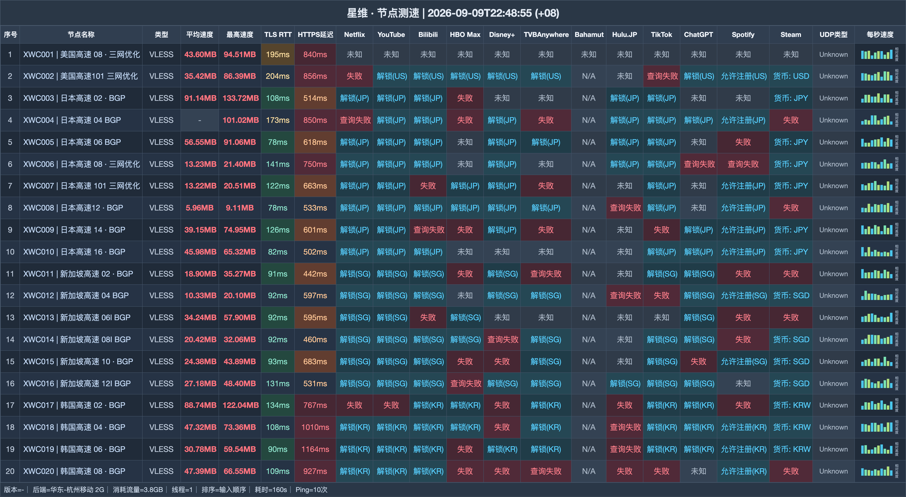

# 星维机场节点与使用场景：测速图怎么读，月付/年付如何选（2026-11-18）

> **先看结论：**星维的产品选择很直接：首次尝试用 8 元 / 160G 月付，长期稳定使用再看 80 元年付、每月 240G，低频需求用 20 元不限时起步包。**现有测速图不能用于承诺星维性能**，因为页面标题与图注的归属不一致，本文只把它作为“如何读图”的待确认参考。
>
> 👉 **[先用月付档验证自己的节点与场景](https://xinweicloud.com/?mode=register&invite=ICg5rb7n)** · 不要仅凭归属有冲突的历史图直接买年付。

## 星维适合哪些使用场景

**更适合：**

- 想从月付开始，先用 8 元购买 160G 验证线路。
- 已完成月付测试，准备改成 80 元年付并按月获得 240G。
- 使用频率低，想买 20 元不限时起步流量。
- 需要月付、年付、两年付和不限时包并列选择。

**不太适合：**

- 购买前必须看到归属明确、与自己网络一致的完整测速证据。
- 想根据现有图直接判断星维比赛博云或赔钱机场更快。
- 续费时希望立即重置流量；相同套餐续费不会重置。
- 不愿先月付验证，就准备直接购买长期套餐。

| 首屏判断 | 已核信息 |
|---|---|
| 月付 | 8 元 / 160G |
| 年付 | 80 元；每月 240G |
| 两年付 | 两年付提供更高月流量 |
| 不限时起点 | 20 元不限时起步包 |
| 续费规则 | 相同套餐续费不重置流量；更换套餐会折抵剩余价值后重置 |
| 现有图规模 | 20 行下载与延迟记录 |
| 图示测试端 | 华东-杭州移动 2G；单线程 |
| 证据边界 | 页面标题与图注归属冲突，不作为星维性能保证 |

## 星维测速图怎么读

现有图片包含 20 行节点记录，列出了平均速度、最高速度、TLS RTT、HTTPS 延迟和流媒体状态。**正确读法是先确认图属于谁，再确认测试环境，最后才看节点表现。**

### 为什么这张图不能直接证明星维性能

- 页面标题与图注对图的归属不一致。
- 测试日期在项目记录中出现 2026-09-07 与 2026-09-09 两种值。
- 图示环境为华东-杭州移动 2G、单线程，与其他两篇的中国大陆家宽出口香港测试不是同一口径。

因此，本文不摘取其中的节点成绩为星维背书，也不据此做三家性能排名。购买前应以自己的订阅、所在城市、运营商和晚高峰重新测试。

### 拿到新测速后，按这个顺序看

1. **核归属：**确认订阅、页面标题和图注都指向星维。
2. **核环境：**记录城市、运营商、带宽、线程数、日期和时段。
3. **看连通：**先排除失败节点，不能只挑最快一行。
- **分开看延迟与速度：**网页交互更关心延迟，大文件更关心持续速度。
- **回到真实场景：**晚高峰、常用设备和目标地区才决定是否续年付。

## 节点选择与使用场景

当前项目内没有一份归属无冲突的星维节点清单可供逐地区结论，因此不能编造“优先香港”“某地区更快”或倍率建议。更稳妥的选择方法是按任务测试：

### 场景一：网页、聊天和日常视频

先用月付档，在自己的网络中测试常用节点的延迟、连续播放和晚高峰表现。不要因单次最高速度决定年付。

### 场景二：长期日常使用

月付验证通过后，再比较年付每月 240G 是否覆盖真实用量。年付是更长期承诺，证据门槛应高于月付。

### 场景三：低频备用

选择不限时起步包，重点确认“多久用完”而非“每月能拿多少”。不限时包可以叠加，但仍应先确认线路可用。

### 场景四：更大月流量

如果月付流量不够，长期方案可看年付或两年付；一次性预算更高时，更要先完成月付实测。

## 全部套餐怎么选

| 类型 | 名称 | 价格 | 流量 | 结算方式 |
|---|---|---:|---:|---|
| 月付 | 月套餐 | 8 元 | 160G/月 | 每月重置 |
| 月付 | 双月套餐 | 15 元 | 160G/月 | 每月重置 |
| 长期 | 年套餐 | 80 元 | 240G/月 | 每月重置 |
| 不限时 | 起步包 | 20 元 | 低频备用 | 用完为止 |

**续费提醒：**续相同套餐不重置流量；换套餐会折抵剩余价值后重置。这个规则比“现在还剩多少流量”更值得在续费前确认。

## 星维、赛博云、赔钱机场怎么选

下面只比较可核产品结构，不做性能排行。赛博云和赔钱机场有 2026-10-17 的历史测试；星维图的日期、环境和归属均不能与它们直接合并。

| 需求 | 更应先看 | 原因 |
|---|---|---|
| 更低门槛月付 | 赔钱机场 | 月付起点低于星维 |
| 多地区、多协议与较高历史连通比例 | 赛博云 | 节点与协议选择更多，且有完整历史测试摘要 |
| 月付、年付、不限时三类结构简单 | 星维 | 三类套餐可直接按使用周期选择 |
| 美区低倍率与大流量 | 赔钱机场 | 低倍率节点集中在美国 |
| 不清零的小额按量包 | 赛博云或星维 | 两家均有小额一次性流量选择 |

## FAQ

### 星维测速怎么样？
现有图不能支持确定结论：页面标题与图注归属冲突，日期记录也不一致。最可靠做法是先买月付并在自己的网络复测。

### 为什么不把图里的最快节点列出来？
在归属确认前，把图内成绩写成星维节点表现会误导购买，因此只保留读图方法和证据边界。

### 月付还是年付？
第一次用选 8 元 / 160G 月付；确认常用节点、晚高峰和流量都符合需求后，再看 80 元年付。

### 不限时包适合谁？
适合低频备用或月用量不稳定的人。不限时起步包为 20 元，用完为止，可以叠加。

### 星维和赛博云、赔钱机场谁更快？
现有证据不能回答。三家的测试环境不统一，星维图还有归属冲突；只能比较套餐与适用场景，不能排性能名次。

## 注册入口

👉 **[进入星维注册页](https://xinweicloud.com/?mode=register&invite=ICg5rb7n)** · 先月付复测，确认后再考虑年付或两年付。

## 重要更新

- **2026-11-22** — 每日复核：套餐、价格与公告无变化；多账号发布对齐核查完成。
- **2026-11-21** — 每日复核：套餐、价格与公告无变化；多账号发布对齐核查完成。
- **2026-11-20** — 每日复核：套餐、价格与公告无变化；多账号发布对齐核查完成。
- **2026-11-19** — 每日复核：套餐、价格与公告无变化；多账号发布对齐核查完成。
- **2026-11-18** — 重构为节点读图、使用场景和三家横向比较指南；明确现有图不承担星维性能承诺。
- **2026-10-31** — 重新编排购买建议与全部套餐，共保留 10 个套餐/展示项。
- **2026-09** — 项目中的历史测速日期存在 2026-09-07 与 2026-09-09 两种记录，等待归属与日期复核。

---
*价格与套餐可能调整，付款前以购买页为准。测速图仅作待确认参考，不构成星维线路保证。*

展开相关搜索词

相关关键词：星维机场测速、星维机场节点、星维机场怎么样、星维机场套餐、星维月付、星维年付、星维不限时、星维与赛博云、星维与赔钱机场、机场测速图怎么看、xinwei、xinweicloud

